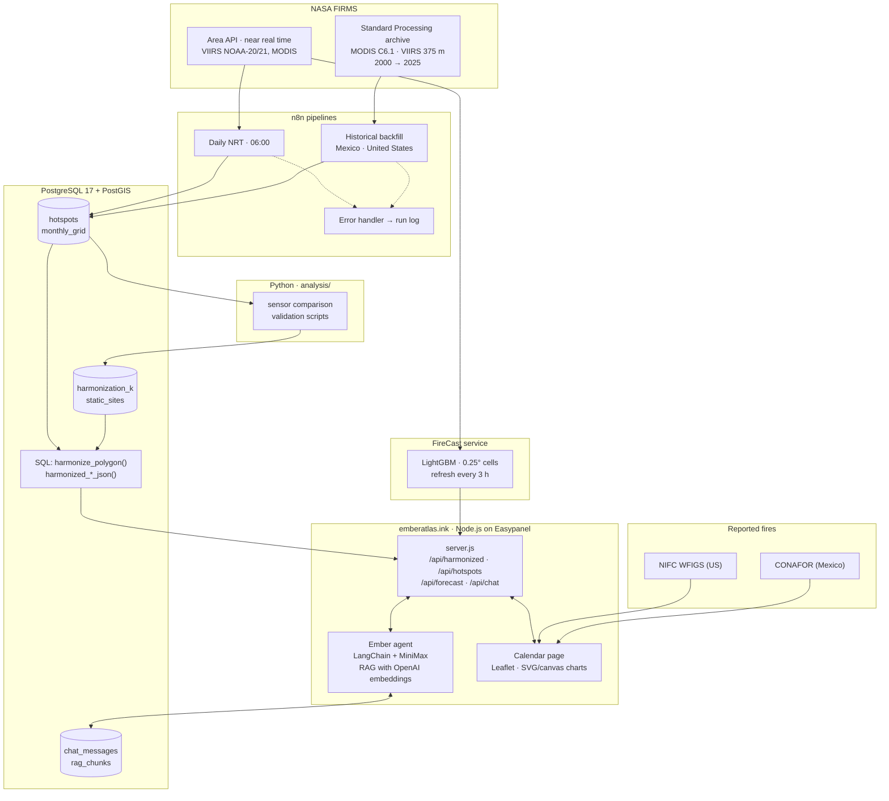
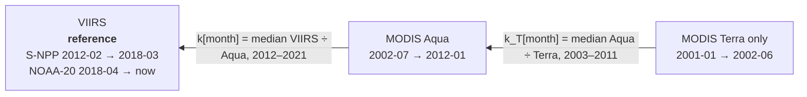

<p align="center">
  <picture>
    <source media="(prefers-color-scheme: dark)" srcset="web-hackathon/public/brand/ember-atlas.svg">
    
  </picture>
</p>

<p align="center">
  <b>A harmonized burning activity calendar from 25 years of NASA MODIS and VIIRS fire hotspots.</b><br>
  2026 NASA Space Apps Challenge · Team <b>A11</b> · Monterrey, Mexico
</p>

<p align="center">
  <a href="https://emberatlas.ink"><b>🔥 Live app: emberatlas.ink</b></a> ·
  <a href="https://emberatlas.ink/deck.html">Pitch deck (7 slides)</a> ·
  <a href="https://www.spaceappschallenge.org/2026/challenges/modis-and-viirs-hot-spots/">The challenge</a>
</p>

<p align="center">
  
  
  
  
  
</p>

---

## The problem in one picture

NASA has watched fires from space since 2000 with **MODIS** (Terra, Aqua) and since 2012 with **VIIRS** (Suomi NPP,
NOAA-20, NOAA-21). VIIRS pixels are finer (375 m vs 1 km), so for the **same fires** it counts about **4.3× more
hotspots**. Put the two records end to end and fire activity seems to explode in 2012, the year VIIRS started. Fire
managers are left without a consistent answer to *"is this month worse than normal?"*

**Ember Atlas** harmonizes both records into one VIIRS-equivalent series, so the sensor of origin no longer matters
and the patterns, trends and anomalies do.

## What you can do with it

| | Feature | Answers |
|---|---|---|
| 🗓️ | **Burning calendar** (month × year, 2001 → this week) | Which months burn, which years were worst |
| 📍 | **Any area:** listed municipalities and protected areas (Mexico, United States), a **polygon you draw**, or a circle around a **lat/lon** | "What about *my* area?" |
| 📊 | **This month vs its history:** median, normal range, percentile, category from *much below* to *record high* (colorblind-safe ColorBrewer RdBu) | Is today unusual? |
| 🌡️ | **Fire season** and *what usually comes next* | When to prepare |
| 🚒 | **Detected vs reported fires:** hotspots against CONAFOR (MX) and NIFC (US) records | How much burning goes unreported |
| 🔮 | **72 h forecast** from our FireCast model | Where fire is likely in the next 3 days |
| ⬇️ | **Downloads** for any date range: hotspots CSV, monthly CSV, PNG calendar and charts, one-page report | Take the data with you |
| 💬 | **Ember**, an assistant that explains the numbers and can operate the page for you | Plain-language answers |
| ⚖️ | **Burn rules** tab (NOM-015 for Mexican areas) | When burning is allowed |

## Architecture



**How a request flows:** the page asks `server.js` for an area → Postgres counts the hotspots inside the polygon per
month and applies the harmonization factors in SQL (~0.1 s per municipality) → the page draws the calendar, compares
the month with its history and asks the FireCast proxy for the next 72 h. Drawn polygons up to 100,000 km² are
computed on the fly. Every push to `main` redeploys the site through a GitHub Action.

## Harmonization: one factor per calendar month

Aqua (MODIS) and VIIRS see the same fire seasons (monthly r ≈ 0.99), but VIIRS counts about **8× more hotspots**, and
that proportion changes with the season. So the method is a ratio per calendar month, measured in the years when
both really flew, with **one reference satellite per sensor** (never summed, so a new launch cannot create a jump):



1. **Divide** VIIRS ÷ Aqua for each month in Mexico (Aqua passes at 13:30, like VIIRS).
2. **Median** over 2012–2021, before the MODIS orbit drift; the interquartile range is the uncertainty band.
3. **Twelve factors k**, one per calendar month (June needs about ×10.7, January about ×5.9).
4. **Translate** the MODIS years: Aqua × k (Terra × k_T × k before Aqua flew). From 2012-02 VIIRS is used as observed.
5. **Compare** each month with its historical median: that colours the calendar.

**Same filters for every sensor:** vegetation fires only, nominal/high confidence. Gas flares and volcanoes are
removed from the near-real-time feed: **95.6 %** of static detections gone, **1.5 %** of vegetation fires lost
(tested out of sample). Everything runs in SQL, including the calibration (`refresh_harmonization_k()`).

**Validation (each year of 2012–2021 hidden, predicted from Aqua, compared with VIIRS):** typical error on the yearly
total **3.7 %** (worst year 2015, +11.5 %), 6.5 % for a single month. `SELECT harmonization_validation_json();`
reruns it on the database.

Against **77,420 fires reported by CONAFOR** (2015–2025) the harmonized monthly series correlates at **r = 0.83**.
Method and limits: [docs/research/14-harmonization-simple.md](docs/research/14-harmonization-simple.md).

**Improvement designed but not implemented:** a regional version (factors per 1° cell × month with shrinkage, a local
correction per area, a 10–90 % band) lowered the monthly error in small areas such as Sierra de Arteaga (36.6 % →
25.8 %). It was left out to keep the method simple; see
[docs/research/13-harmonization-v2.md](docs/research/13-harmonization-v2.md).

## FireCast: the 72-hour forecast

| | |
|---|---|
| **Target** | At least one VIIRS hotspot in a 0.25° cell in the next 3 days |
| **Model** | LightGBM, global, on VIIRS NOAA-20 history (static sources removed) |
| **Features** | Hotspots in the last 1/3/7/30 days, fire days, FRP, days since last fire, neighbouring cells, the cell's climatology for that time of year, location, season |
| **Test (all of 2025)** | **AUC 0.914** vs 0.849 climatology and 0.814 persistence; calibrated (says 72 % → happened 69 %) |
| **Live** | Pulls the last 30 days of FIRMS NRT and refreshes every 3 h; the area's chance is `1 − Π(1 − p_cell)` |

FireCast runs as its own service; the site reaches it through the `/api/forecast` proxy. Details:
[web-hackathon/FORECAST.md](web-hackathon/FORECAST.md).

## Ember: an assistant that uses the page

<p align="center">
  
</p>

Ember is a small flame with an expression engine ([ember.js](web-hackathon/public/ember.js), no dependencies). Its
mood mirrors the conversation; the animations above are recorded from the real engine.

<p align="center">
  
</p>

The agent harness ([chat-agent.js](web-hackathon/chat-agent.js)) runs on the server. Server tools run there and loop
straight back to the model; page tools are sent to the browser, where [agent.js](web-hackathon/public/agent.js) plays
them with a visible cursor and posts the results back, so the model can continue. When Ember searches the documents,
the chat shows it as the **Researcher**, a small blue Ember with the query and the sections it found.

- **13 page tools** (search an area, set the month, layers, hotspot filter, area around a point, downloads…) plus
  **document search** over [web-hackathon/knowledge/](web-hackathon/knowledge/).
- **Grounded:** every number in a reply must come from the page, a tool result or a doc section; otherwise the reply
  is rewritten without it. The model key never reaches the browser.
- **Memory** in Postgres, compacted into a summary for long conversations. Replies in the user's language.

More: [web-hackathon/README.md](web-hackathon/README.md).

## Data pipelines

Seven n8n workflows keep the database current (JSON in [n8n/workflows/](n8n/workflows/), generated by
[n8n/build_workflows.py](n8n/build_workflows.py)):

| Workflow | What it does |
|---|---|
| DB setup | Applies the schema ([analysis/db/schema.sql](analysis/db/schema.sql)) |
| Load FIRMS CSV | Sub-workflow: stages a CSV, Postgres parses it with `load_staged()` |
| Historical backfill (Mexico, United States) | FIRMS country files 2000–2025 + 2026 from the Area API |
| **Daily NRT** | Every day at 06:00: new detections, drops NRT rows covered by the archive, rebuilds `monthly_grid` |
| DB status | Row counts, freshness and errors |
| Error handler | Marks failed runs in `pipeline_runs` |

Details and caveats: [n8n/README.md](n8n/README.md).

## Tech stack

| Layer | Tools |
|---|---|
| Data | NASA FIRMS (archive + Area API), CONAFOR, NIFC WFIGS |
| Pipelines | n8n |
| Storage and spatial queries | PostgreSQL 17, PostGIS 3.5 |
| Harmonization and analysis | Python 3.12 (standard library + numpy), SQL |
| Forecast | LightGBM (FireCast service) |
| Web | Node.js 22 (`server.js`), HTML/CSS/JavaScript, Leaflet, hand-made SVG/canvas charts |
| Assistant | LangChain.js, MiniMax (OpenAI-compatible API), OpenAI `text-embedding-3-small` |
| Hosting | Docker on Easypanel, GitHub Actions deploy, Let's Encrypt |

## Repository map

```
.
├── web-hackathon/        ★ The deployed app (emberatlas.ink)
│   ├── server.js           API: harmonized series, hotspots, forecast proxy, chat
│   ├── chat-agent.js       Ember agent (LangChain) · rag.js document search
│   ├── public/             Calendar page, Ember UI, pitch deck (deck.html), brand
│   ├── knowledge/          Documents Ember searches
│   └── DATA_CONTRACT.md    Format of the harmonized series · FORECAST.md
├── analysis/
│   ├── harmonization/      Regional v2 scripts (improved method, not used by the app)
│   ├── db/                 schema.sql, harmonization.sql, chat_memory.sql, rag.sql
│   └── *.py                Sensor comparison, pixel matching, reported fires, explorer data
├── n8n/                  Pipelines (workflow JSON + generator)
├── docs/research/        Study of the challenge, users, interface and method (01–13)
├── web/                  Fire Data Explorer: 3D globe used to understand the raw data
└── data/                 Raw downloads (git-ignored, see data/README.md)
```

## Research behind it

| # | Document |
|---|---|
| 01 | [Challenge brief](docs/research/01-challenge-brief.md) |
| 02 | [Data sources: NASA FIRMS](docs/research/02-data-sources-firms.md) |
| 03 | [MODIS vs VIIRS empirical comparison](docs/research/03-sensor-comparison.md) |
| 04 | [Harmonization approaches](docs/research/04-harmonization-approaches.md) |
| 05 | [Web app requirements & architecture](docs/research/05-web-app-requirements.md) |
| 06 | [Submission rules that affect us](docs/research/06-submission-rules.md) |
| 07 | [Understanding the data (satellites, coverage, a reading, the overlap)](docs/research/07-understanding-the-data.md) |
| 08 | [End users](docs/research/08-end-users.md) |
| 09 | [User research and use cases](docs/research/09-user-research-and-use-cases.md) |
| 10 | [Interface design](docs/research/10-interface-design.md) |
| 11 | [UI audit and references](docs/research/11-ui-audit-and-references.md) |
| 12 | [Harmonization: state of the art](docs/research/12-harmonization-state-of-the-art.md) |
| 13 | [Harmonization v2: regional calibration (improved, not implemented)](docs/research/13-harmonization-v2.md) |
| 14 | [Harmonization: one factor per calendar month (used by the app)](docs/research/14-harmonization-simple.md) |
| — | [References](docs/research/references.md) |

Key findings: on Mexico 2019–2024, VIIRS NOAA-20 detects ~4.2× more hotspots than MODIS, but the monthly series
correlate at **r ≈ 0.995**: the fire *timing* agrees, so harmonization is mainly a *scale* problem. Suomi NPP stopped
delivering data on Nov 2, 2026; VIIRS continuity is NOAA-20 / NOAA-21.

## Run it

**Analysis** (Python 3.10+; downloads are cached in `data/raw/`):

```bash
python analysis/sensor_overlap.py --country Mexico --years 2019 2020 2021 2022 2023 2024
```

**Harmonization:** apply `analysis/db/harmonization.sql` on the database after `schema.sql` (it computes the factors
itself), then check it:

```sql
SELECT harmonization_validation_json();
```

**Web app** (Node 22). Without a database it serves sample series from `public/data/harmonized/`:

```bash
cd web-hackathon && npm install && npm start
```

**Fire Data Explorer** (3D globe):

```bash
python web/server.py
```

**FIRMS key:** `cp .env.example .env`, then set `FIRMS_MAP_KEY` (free at
https://firms.modaps.eosdis.nasa.gov/api/map_key/). `.env` is git-ignored: never commit the key or put it in
front-end code.

## Limits we know about

- Factors are national (Mexico) and apply everywhere, so small areas are noisy; US areas use Aqua × k until NOAA-20 (no S-NPP downloaded for the US).
- The Terra-only months (2001–mid 2002) are the least certain; the page shows the range.
- Months are UTC months, without a day/night split.
- The forecast is a probability, not a guarantee; the area chance assumes independent cells.

## Team A11 (Monterrey)

**Leonardo Sáenz** · **José Ángel Ipiña** · **Abiel Jefté Ramírez**

## Data acknowledgment

We acknowledge the use of data and/or imagery from NASA's Fire Information for Resource Management System
(FIRMS) (https://earthdata.nasa.gov/firms), part of NASA's Land, Atmosphere Near real-time Capability for Earth
observations (LANCE) (https://earthdata.nasa.gov/lance) and NASA's Earth Science Data and Information System
(ESDIS). Reported fires: CONAFOR wildfire records (datos.gob.mx, CC BY 4.0) and NIFC Wildland Fire Incident
Locations (WFIGS). Basemap © Esri, HERE, Garmin, © OpenStreetMap contributors.

## AI (SI) assistance disclosure

As required by the Space Apps 2026 SI rules, we disclose where AI tools were used:

- **Code and data processing:** parts of the code (web app, Node server, SQL, n8n pipelines, Python analysis and
  harmonization scripts) were drafted with an AI coding assistant (Claude, by Anthropic) and reviewed, tested and
  validated by the team. All quantitative results are reproducible with the scripts in `analysis/`.
- **Text:** research documents, READMEs and the knowledge documents were drafted with AI assistance and reviewed by
  the team.
- **In the product:** the Ember assistant runs on a large language model (MiniMax, via LangChain) and uses OpenAI
  embeddings to search our own documents (`web-hackathon/knowledge/`). The page tells users that Ember can be wrong.
- No NASA logos or branding were generated or modified with AI.
